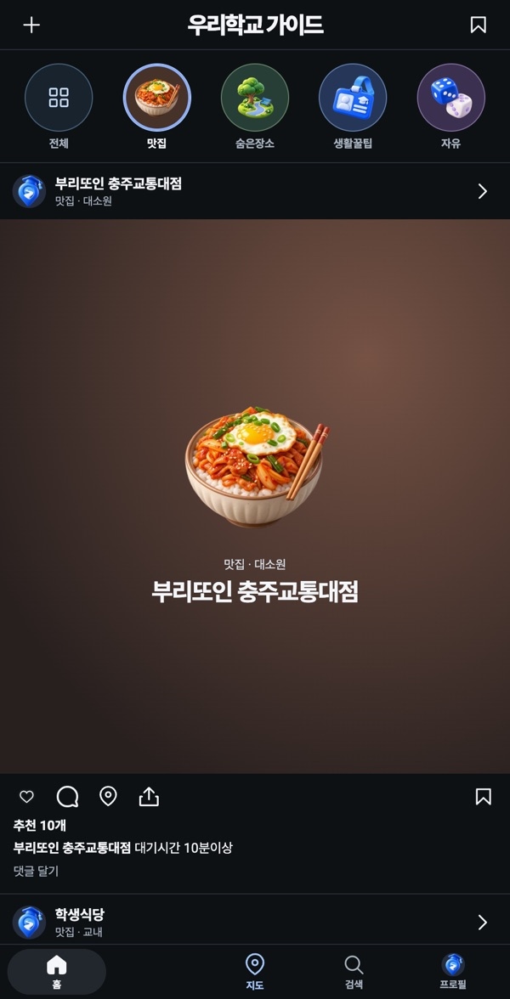
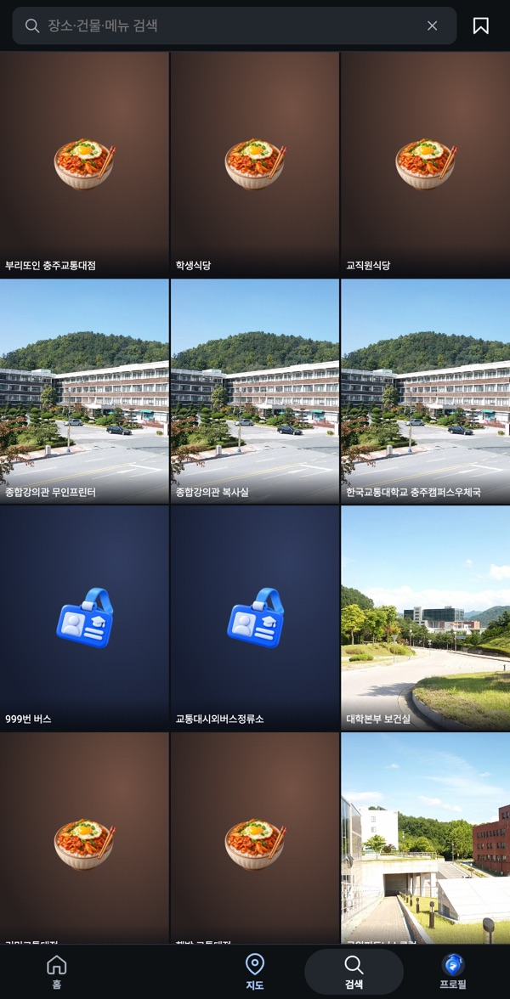
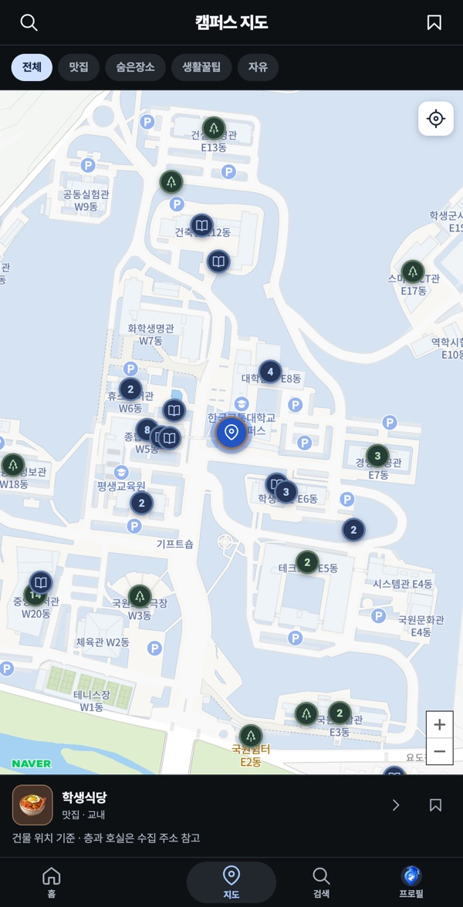

<p align="center">
  
</p>

<h1 align="center">우리학교 가이드</h1>

<p align="center">
  한국교통대 충주캠퍼스의 맛집 · 숨은장소 · 생활꿀팁을<br>
  인스타그램처럼 넘겨 보고, 지도에서 바로 찾는 모바일 웹
</p>

<p align="center">
  <a href="https://kth4778.github.io/knut-campus-guide/"><b>🔗 바로 써보기</b></a>
</p>

<p align="center">
  
  
  
  
</p>

## 화면

<table>
  <tr>
    <th>홈 피드</th>
    <th>검색</th>
    <th>지도</th>
  </tr>
  <tr>
    <td></td>
    <td></td>
    <td></td>
  </tr>
  <tr>
    <td>위쪽 동그라미로 분류를 고르면<br>그 분류 게시물만 보여요</td>
    <td>장소·건물·메뉴로 찾고,<br>누르면 지도로 바로 가요</td>
    <td>고른 장소의 핀이<br>파랗게 강조돼요</td>
  </tr>
</table>

## 주요 기능

- **계정 (누팁스)** — 홈 맨 위 동그라미: 교통대 제휴(48곳) · 식사 · 카페 · 술 · 공부 · 휴식 · 운동 · 생활편의 · 교통 · 자취방 · 기숙사 · 꿀팁 4종. 누르면 계정 화면(프로필 + 게시물 격자)
- **홈 피드** — 추천 많은 곳 사이사이에 제휴 혜택과 오늘의 꿀팁이 섞여요 (날짜마다 순서가 바뀜)
- **검색 → 지도** — 좌표가 있는 장소는 `#/map?focus=<ID>`로 바로 이동해 핀을 강조하고, 좌표가 없는 글은 상세로 열려요
- **지도** — 같은 건물의 장소는 핀 하나로 묶고, 누르면 목록이 떠요
- **좋아요 · 댓글 · 저장 · 글쓰기** — 각자 브라우저에 저장돼요
- **버스** — 지도 `버스` 분류에서 학교 주변 정류장 20곳, 정류장별 실시간 도착 정보, 고른 노선(최대 4개)의 버스 위치
- **고속버스** — 교통대 정류소·충주터미널의 서울행 시간표·요금과 달리는 버스 위치
- **MOA** — 하단 탭으로 들어가요. 배달 같이 시키기 · 픽업해서 같이 먹기(N빵 계산) · 택시 같이 타기 모집글 쓰기·참여

버스·고속버스·MOA는 누팁스(KNUTIPS) 앱에서 옮겨 온 기능이에요.

## 로컬에서 실행

빌드 과정이 없어요. `dist/`가 편집하는 곳이자 그대로 배포되는 폴더예요. `main`에 push하면 GitHub Actions가 `dist/`를 GitHub Pages에 자동으로 배포해요.

```bash
python3 -m http.server 8853 --bind 127.0.0.1 --directory dist
```

브라우저에서 http://127.0.0.1:8853 을 열고, 개발자 도구에서 모바일 화면 크기로 보세요.

## 테스트

Playwright E2E 테스트 58개가 있어요. 계획·결과: [docs/E2E_TEST_PLAN.md](docs/E2E_TEST_PLAN.md)

```bash
npm ci                 # 처음 한 번
npm run test:p0        # push 전에: 배포를 막는 P0 테스트만
npm run test:e2e       # 전체
```

main 에 push 하면 GitHub Actions 가 테스트를 돌리고, **통과해야만 배포**돼요.

## 누팁스 데이터 합치기

`dist/data/places.json`은 누팁스(KNUTIPS) 앱 데이터를 합친 것이에요. 누팁스 분류(`kCat`)로 계정을 나눠요.
제휴 매장은 `dist/data/partners.json`이에요. 누팁스 데이터가 바뀌면 다시 돌려요(여러 번 돌려도 결과가 같아요).

```bash
python3 scripts/merge_knutips.py <누팁스 knutips_app 폴더>
```

이름만 조금 다른 같은 곳은 스크립트의 `SAME_PLACE`에 손으로 적어요.

## 파일 구성

| 파일 | 하는 일 |
|---|---|
| `dist/index.html` | 화면 틀(상태바·본문·하단 탭) |
| `dist/app.js` | 화면 그리기, 주소(`#/...`)에 따른 화면 전환, 지도, 저장·좋아요·댓글 |
| `dist/transit.js` | 버스 정류장·고속버스 터미널 데이터와 TAGO API 호출(도착·시간표·버스 위치) |
| `dist/moa.js` · `dist/moa.css` | MOA 화면과 모집하기 |
| `dist/config.js` | 버스 API 키 자리. 저장소에는 키를 비워 두고, 배포 때 Secret으로 채워요 |
| `dist/config.example.js` | 키 넣는 방법 안내용 예시 |
| `dist/data/bus-routes.json` | 학교 주변을 지나는 충주 시내버스 노선 (TAGO, 2026-11-12 기준) |
| `dist/style.css` | 스타일 |
| `dist/data/places.json` | 장소·정보 321개(좌표 있는 곳 242개). 장소 ID(`P089` 등)를 검색·상세·지도·저장이 함께 써요 |
| `dist/vendor/` | Leaflet 1.9 (네이버 지도를 못 쓸 때 쓰는 대체 지도) |

## 화면과 주소

| 주소 | 화면 |
|---|---|
| `#/` · `#/?category=맛집` | 홈 피드(카테고리 필터) |
| `#/search` | 검색. 좌표가 있는 장소는 지도로, 없는 글은 상세로 열려요 |
| `#/map?focus=P089` | 지도에서 해당 장소 핀 강조 |
| `#/map?category=버스` · `#/map?category=고속버스` | 지도에서 버스 정류장 · 고속버스 터미널 |
| `#/moa` | MOA 모집글 |
| `#/place?id=P178` | 장소 상세 |
| `#/my` · `#/my?tab=saved` | 프로필의 게시물·저장 격자 |

하단 탭은 `홈 | MOA | 지도 | 검색 | 프로필` 순서예요. 지도는 가운데에 둬요.

## 지도

네이버 지도 JavaScript API v3를 먼저 불러와요. SDK를 못 받거나 인증에 실패하면 Leaflet + OpenStreetMap으로 바뀌어요.

네이버 지도는 네이버 클라우드 Maps 애플리케이션에 **등록된 주소에서만** 떠요. 배포 주소 `https://kth4778.github.io`도 등록돼 있어요. 등록된 로컬 주소는 `http://localhost:5178`이에요. 다른 포트(예: 8853)에서는 Leaflet 지도가 떠요. 이건 고장이 아니에요.

## 버스 API 키

버스·고속버스 실시간 정보는 공공데이터포털(data.go.kr)의 국토교통부 TAGO API를 써요. 키는 공개 저장소에 올리지 않아요.

- **내 컴퓨터에서:** 먼저 `git update-index --skip-worktree dist/config.js`를 실행한 뒤, `dist/config.js`의 `BUS_API_KEY`에 "일반 인증키(Encoding)"를 넣어요. 그러면 git이 이 파일 변경을 무시해서 키가 커밋되지 않아요.
- **배포(GitHub Pages):** 저장소 Settings → Secrets and variables → Actions에 `BUS_API_KEY`를 넣으면 배포할 때 키가 든 `config.js`로 바꿔 넣어요.
- 키가 없으면 정류장·터미널 위치와 네이버·카카오 지도 링크만 보여요.
- 활용신청할 API: 버스도착정보, 버스정류소정보, 버스위치정보, 고속버스정보, 고속버스도착정보

## 알아둘 것

- 좋아요·댓글·작성한 게시물·저장·MOA 모집글은 각자 브라우저(localStorage)에만 저장돼요. 다른 사람과 공유되지 않아요.
